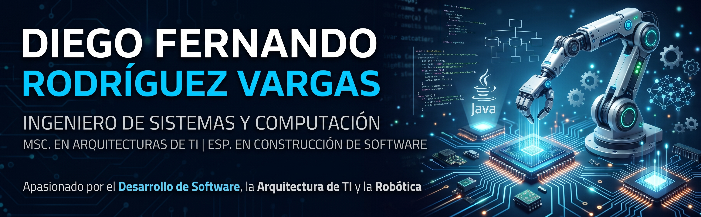

# Hola, soy Diego Fernando Rodríguez Vargas 👋

### Ingeniero de Sistemas y Computación | MSc. en Arquitecturas de TI | Esp. en Construcción de Software

📍 **Ubicación:** Bogotá, Colombia  
📧 **Correo:** [nanofer2@gmail.com](mailto:nanofer2@gmail.com)  
💼 **LinkedIn:** [linkedin.com/in/drodriguezv1985](https://www.linkedin.com/in/drodriguezv1985)

---

## 👨‍💻 Sobre Mí

Soy un Ingeniero de Sistemas con más de 10 años de experiencia en el desarrollo de aplicativos en tecnología **Java** y **Arquitectura Empresarial**. A lo largo de mi trayectoria he liderado proyectos y equipos de trabajo multidisciplinarios. Uno de los hitos más destacados de mi carrera fue recibir, junto a mi equipo, una felicitación oficial por parte de la **Embajada de los EE. UU.** al entregar exitosamente el sistema TLC en la fecha establecida.

Actualmente formo parte del equipo de **Transformación Digital de la DIAN**, participando activamente en procesos de arquitectura empresarial, análisis de tendencias tecnológicas y selección de soluciones que optimizan los procesos de la entidad. Me apasiona mi profesión porque cada día representa un nuevo reto y una oportunidad para transformar el mundo a través de la tecnología.

---

## 🛠️ Stack Tecnológico y Competencias

### **Lenguajes y Frameworks**

### **Bases de Datos**

### **Arquitectura y Metodologías**

### **Habilidades Blandas (Soft Skills)**
* ✅ Liderazgo de equipos
* ✅ Trabajo colaborativo
* ✅ Manejo de la frustración y resiliencia
* ✅ Comunicación asertiva
* ✅ Adaptación al cambio

---

## 📊 Estadísticas de GitHub

  
  

---

## 🚀 Experiencia Laboral

### **UAE DIAN** | *2011 – Actualidad*
**Rol:** Desarrollador de Software Sr., Analista de Software, Arquitecto Empresarial Jr.

* **Desarrollo y Arquitectura:** Análisis, diseño y desarrollo de nuevas soluciones en **Java** con bases de datos **Oracle**, bajo metodología **RUP**.
* **Mantenimiento Evolutivo:** Ajustes, actualización y mantenimiento continuo de funcionalidades críticas.
* **Modelado de Procesos:** Análisis y diseño de procesos de negocio aduaneros utilizando diagramas **BPMN** y especificación de requerimientos.
* **Liderazgo Técnico:** Líder de grupo, brindando soporte técnico y de negocio para la implementación de mejoras en los sistemas.
* **Transformación Digital:** Participación activa en la actualización de estados *As-Is* y *To-Be* de la entidad para la modernización de proyectos institucionales.

### **IBISCOM** | *2009 – 2011*
**Rol:** Desarrollador de Software Jr.

* **Desarrollo Full-Stack / Backend:** Análisis, diseño y codificación en **Java** integrando motores de bases de datos como **Oracle, MySQL, PostgreSQL y Apache Derby**.
* **Proyecto SIPO:** Levantamiento de requerimientos, desarrollo, capacitación a usuarios y puesta en producción del aplicativo.
* **Proyecto SIDER (INCODER):** Modelado de procesos de negocio mediante diagramas **BPMN**, diseño y codificación de requerimientos.

---

## 🎓 Educación

* **Magíster en Arquitectura de Tecnologías de la Información**  
  *Universidad de los Andes* | 2014 – 2017  
  *Proyecto de grado (Modalidad Práctica):* Implementación de Arquitectura de Datos para la empresa Seguros Mundial.

* **Especialista en Construcción de Software**  
  *Universidad de los Andes* | 2013 – 2014  
  *Proyecto de grado (Modalidad Práctica):* Laboratorio Marketplace de los Alpes (arquitectura empresarial e implementación y desarrollo de componentes).

* **Ingeniero de Sistemas y Computación**  
  *Universidad Pedagógica y Tecnológica de Colombia (UPTC)* | 2002 – 2008

---

## 🏆 Reconocimientos

* **Felicitación Oficial – Embajada de los Estados Unidos:** Por el cumplimiento exitoso de objetivos y entrega puntual en la implementación del sistema para el Tratado de Libre Comercio (TLC).

---

## 🌐 Idiomas y Pasatiempos

| Idiomas | Pasatiempos e Intereses |
| :--- | :--- |
| 🇨🇴 **Español:** Lengua nativa | 🏊‍♂️ Natación |
| 🇺🇸 **Inglés:** Nivel B1 | ⚽ Fútbol |
| | 🎮 Videojuegos |
| | 👨‍🍳 Cocinar |
